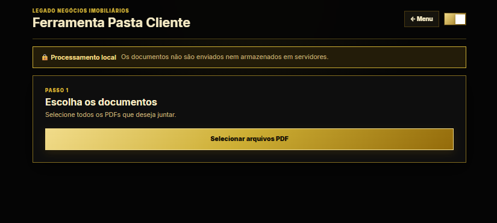
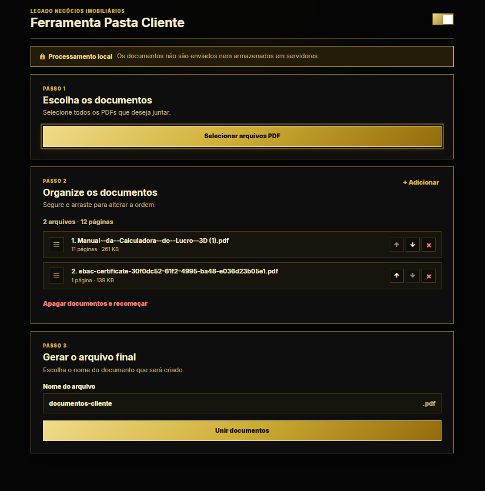
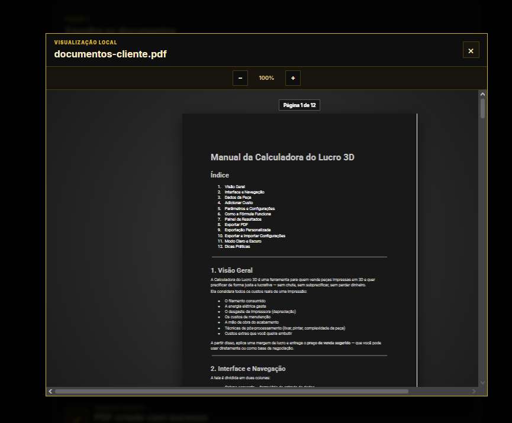

# ImobHelper

**Ferramentas web para simplificar rotinas imobiliárias, com processamento local de arquivos.**

O **ImobHelper** é um projeto independente, idealizado e desenvolvido por **Sávio Petrus**, para resolver necessidades práticas de organização documental e preparação de contatos no contexto imobiliário. A aplicação reúne duas ferramentas em uma interface web: **Pasta Cliente** e **Lista WhatsApp**.

> **Acesso restrito:** a aplicação utiliza autenticação por e-mail com código de acesso e lista de e-mails autorizados, configurada com Cloudflare Access. Este repositório é uma **apresentação do projeto**: não disponibiliza código-fonte, credenciais nem acesso público ao sistema.

## Visão geral

### 1. Lista WhatsApp

Ferramenta de apoio à preparação de contatos, com fluxo simples para importar uma planilha, editar a mensagem e abrir a conversa correspondente.

- Importação de planilhas Excel com nomes e telefones;
- Tratamento e validação de números de telefone;
- Pesquisa de contatos por nome ou telefone;
- Personalização de mensagens com a variável `{nome}`;
- Abertura de conversas com texto preenchido no WhatsApp, **sem envio automático**;
- Leitura e tratamento dos dados da planilha no navegador.

**Importação e edição da mensagem**

**Lista de contatos e validação de telefones**

### 2. Pasta Cliente

Ferramenta para reunir documentos PDF em um único arquivo, auxiliando na preparação de pastas para análise de crédito e outras rotinas documentais.

- Seleção de múltiplos arquivos PDF;
- Organização e alteração da ordem dos documentos;
- Remoção de arquivos antes da geração;
- União dos PDFs em um arquivo final;
- Visualização do PDF gerado com controle de zoom;
- Opções de salvar e compartilhar o documento;
- Processamento dos documentos localmente no navegador, sem upload dos arquivos para um servidor da aplicação.

**Seleção dos documentos**

**Organização da pasta**

**Geração e opções do PDF final**

**Visualização do documento**

## Tecnologias utilizadas

| Área | Tecnologias |
| --- | --- |
| Interface | HTML5, CSS3 e JavaScript (ES Modules) |
| Ferramentas de desenvolvimento | Vite e npm |
| Planilhas | SheetJS (`xlsx`) |
| Documentos PDF | `pdf-lib` e PDF.js (`pdfjs-dist`) |
| Hospedagem e acesso | Cloudflare Pages e Cloudflare Access |
| Recursos do navegador | File API, Canvas API, Web Share API e APIs de download |

## Decisões de projeto

**Privacidade por concepção.** As ferramentas foram pensadas para manipular planilhas e documentos diretamente no navegador, evitando a necessidade de enviar arquivos de clientes a serviços de conversão ou armazenamento externos. O controle de acesso à interface é uma camada adicional, distinta do processamento local dos documentos.

**Fluxos voltados à tarefa.** Cada ferramenta apresenta as etapas na ordem de uso, com ações de seleção, revisão e finalização. O objetivo é tornar tarefas repetitivas mais práticas.

**Desenvolvimento orientado a problemas reais.** O projeto envolveu definição de funcionalidades, implementação, testes manuais, identificação de falhas e ajustes de comportamento em diferentes dispositivos e navegadores. Consultas técnicas pontuais foram utilizadas como apoio durante o desenvolvimento.

## Disponibilidade e demonstração

O ImobHelper está implantado em ambiente de acesso restrito. Para conhecer seu funcionamento, consulte as capturas de tela neste repositório. Uma demonstração acompanhada pode ser realizada pelo desenvolvedor, sem exposição de documentos de clientes.

**Código-fonte:** privado / não publicado neste repositório.

## Sobre o desenvolvedor

**Sávio Petrus** — desenvolvimento de software e experiência em infraestrutura e suporte de TI.

- [GitHub](https://github.com/SavioPetrus)
- [LinkedIn](https://www.linkedin.com/in/saviopetrus/)

---

*As imagens são demonstrações da interface. Dados de contato exibidos nas capturas foram substituídos por exemplos fictícios.*
